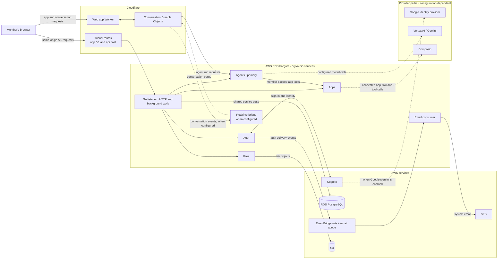

This is a source-based map of the core browser, agent, app, file, auth, and email paths, not a live traffic trace. Cloudflare routes, provider calls, and the Realtime bridge depend on deployment configuration. Dodo billing is omitted from the beta scope; Slack bot and native phase-2 integration paths are not shown as active routes.

## Source legend

- [Production ingress routes](https://github.com/Shubham04-oss/oryxa-go/blob/611233f541a3980c3b38490abe665116e567a0e7/deploy/production/cloudflare.tf#L1-L74) and [ECS service boundary](https://github.com/Shubham04-oss/oryxa-go/blob/611233f541a3980c3b38490abe665116e567a0e7/deploy/production/compute.tf#L1-L4).
- [Web Worker and agent-chat path](https://github.com/Shubham04-oss/oryxa-go/blob/611233f541a3980c3b38490abe665116e567a0e7/web-next/README.md#L35-L61), plus the [optional Realtime bridge](https://github.com/Shubham04-oss/oryxa-go/blob/611233f541a3980c3b38490abe665116e567a0e7/realtime/README.md#L3-L20).
- [Auth and Cognito](https://github.com/Shubham04-oss/oryxa-go/blob/611233f541a3980c3b38490abe665116e567a0e7/auth/README.md#L3-L19), [agent model](https://github.com/Shubham04-oss/oryxa-go/blob/611233f541a3980c3b38490abe665116e567a0e7/agents/primary/README.md#L1-L18), [agent-to-app tools](https://github.com/Shubham04-oss/oryxa-go/blob/611233f541a3980c3b38490abe665116e567a0e7/agents/primary/README.md#L172-L185), and the [Composio app boundary](https://github.com/Shubham04-oss/oryxa-go/blob/611233f541a3980c3b38490abe665116e567a0e7/apps/README.md#L12-L32).
- [Shared service database](https://github.com/Shubham04-oss/oryxa-go/blob/611233f541a3980c3b38490abe665116e567a0e7/README.md#L35-L40) and [RDS PostgreSQL resource](https://github.com/Shubham04-oss/oryxa-go/blob/611233f541a3980c3b38490abe665116e567a0e7/deploy/production/database.tf#L1-L4); [Files and S3](https://github.com/Shubham04-oss/oryxa-go/blob/611233f541a3980c3b38490abe665116e567a0e7/files/README.md#L3-L20), [email events and SES](https://github.com/Shubham04-oss/oryxa-go/blob/611233f541a3980c3b38490abe665116e567a0e7/email/README.md#L1-L24), and [production model configuration](https://github.com/Shubham04-oss/oryxa-go/blob/611233f541a3980c3b38490abe665116e567a0e7/deploy/production/compute.tf#L121-L146).

All links target source at release `611233f541a3`; this page was reviewed against source only.
